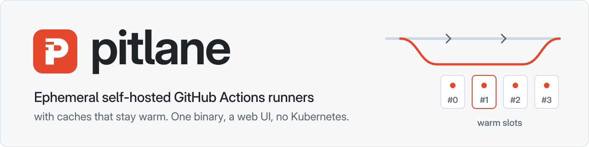
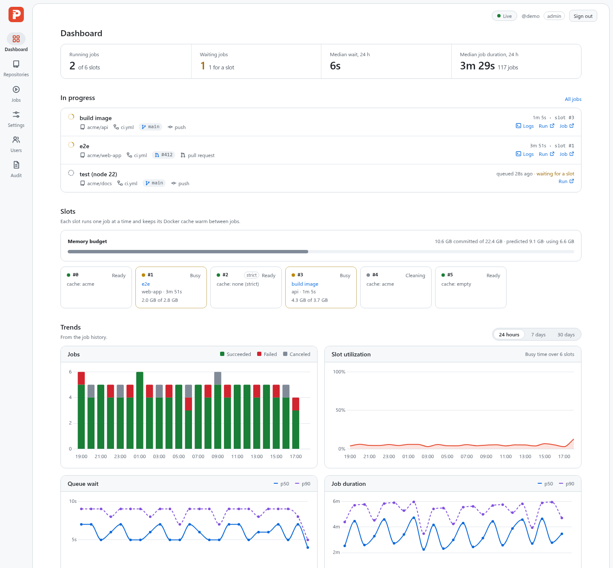
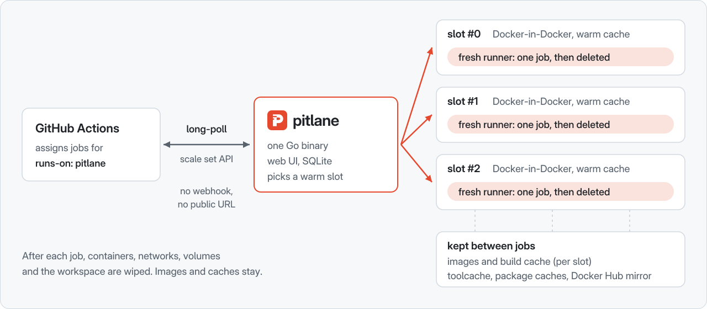

<p align="center">
  <picture>
    <source media="(prefers-color-scheme: dark)" srcset="docs/assets/hero-dark.svg">
    
  </picture>
</p>

<p align="center">
  <a href="#quick-start">Quick start</a> ·
  <a href="#faster-than-github-hosted-runners">Benchmark</a> ·
  <a href="#compared-with-the-alternatives">Alternatives</a> ·
  <a href="#how-it-works">How it works</a> ·
  <a href="https://turoyt.github.io/pitlane/">Docs</a>
</p>

**Pitlane gives every GitHub Actions job a fresh runner on your own Docker host,
and keeps Docker layers, package caches and toolchains on disk so the next job
starts warm.**

It is for people who run CI for private repositories on GitHub, have a Linux
machine to spare (a VM, a Proxmox LXC container, a server), and want
autoscaled ephemeral runners without running Kubernetes.

Measured on a real private monorepo, with Pitlane in a 12-vCPU Proxmox LXC
container:

- **Whole CI: ~6 min 30 on GitHub-hosted runners, ~3 min on Pitlane.**
- **Docker image builds and smoke test: 393 s → 127 s**, because layers and
  `services:` images are already in the slot.
- **`actions/cache`: 200 MB saved in about 1 s**, against about 9 s on GitHub's
  cache, with no workflow change (strict jobs for public repositories keep
  GitHub's cache).

```yaml
jobs:
  build:
    runs-on: pitlane
```

<picture>
  <source media="(prefers-color-scheme: dark)" srcset="docs/assets/dashboard-dark.png">
  
</picture>

<sub>Screenshot with demo data.</sub>

## Quick start

On a Linux host with systemd (Docker is installed if missing):

```sh
curl -fsSL https://github.com/TuroYT/pitlane/releases/latest/download/install.sh | sudo sh
```

Or with Docker Compose:

```sh
curl -O https://raw.githubusercontent.com/TuroYT/pitlane/main/deploy/compose.yaml
PITLANE_BASE_URL=http://my-server:8080 docker compose up -d
```

Or on Proxmox VE (creates a ready-to-use LXC container):

```sh
bash -c "$(curl -fsSL https://github.com/TuroYT/pitlane/releases/latest/download/pitlane-lxc.sh)"
```

Then:

1. Open the printed URL and enter the setup token (`sudo pitlane setup-token`, `docker compose exec pitlane /pitlane setup-token` with Compose, or `pct exec <CTID> -- pitlane setup-token` on the Proxmox host; details in [Getting started](docs/getting-started.md)).
2. Click **Create GitHub App**, then install the App on your account or organization.
3. Sign in with GitHub, go to **Repositories** and click **Enable**.
4. In your workflows:

   ```yaml
   jobs:
     build:
       runs-on: pitlane
   ```

That's it. See [Getting started](docs/getting-started.md) for details.

## Why Pitlane

- **A fresh runner for every job, with warm caches.** Each job gets a brand-new runner. Docker images, build layers, `npm`/`pnpm`/`yarn`/`pip`/Go caches and toolchains stay on disk between jobs, and `actions/cache` restores and saves from the Pitlane host instead of GitHub's cache (except for strict jobs, which keep GitHub's cache).
- **Docker works as on GitHub.** `services:`, `container:` jobs and `docker build` work out of the box. Each slot has its own Docker-in-Docker daemon, and jobs never touch the host's Docker.
- **Jobs start within seconds, with no public URL.** Pitlane long-polls GitHub through the official scale set API, the one GitHub's Kubernetes controller uses. There is no webhook to expose.
- **A web UI to see what runs where.** Live slots and runners, every job traced back to its repository, workflow, branch or pull request and run on GitHub, wait and duration trends, per-job peak memory, runner logs, one-click repository enablement, settings applied live.
- **Two-minute setup.** Pitlane creates its own GitHub App in one click and uses it to sign you in with GitHub.
- **Several people, with roles.** Sign in with GitHub as `admin`, `operator` or `viewer`, by login or by organization and team rules. Admin actions go to an audit log.
- **Public repositories run strict.** Their jobs get throwaway caches and a wiped Docker daemon before and after each job. Read [Security](docs/security.md) before you enable one: strict mode is not a sandbox.
- **One static binary.** Install it with systemd, Docker Compose, or a one-liner on Proxmox. Installed as a binary, it updates itself from the web UI and refuses a binary whose Sigstore build attestation does not check out; with Compose, you pull the new image.

## Faster than GitHub-hosted runners

Measured on a real-world private monorepo CI (pnpm workspace, Nuxt + Prisma, Postgres/Redis
service containers, three Docker image builds), all jobs running in parallel, warm caches.
Pitlane ran in an unprivileged Proxmox LXC container with 12 vCPU and a modest RAID disk.

| | GitHub-hosted (`ubuntu-latest`) | Pitlane |
| --- | --- | --- |
| **Whole CI (longest job)** | **~6 min 30** | **~3 min** |
| Job pickup | queue + VM boot | 6 s |
| Docker images & smoke test | 393 s | **127 s** (3.1×) |
| Dependency install (`setup` step) | 30–40 s | **21–26 s** |
| Prisma migrations | 77 s | **59 s** |
| Lint & format | 40 s | **38 s** |
| Unit tests | 161 s | **159 s** |

The biggest wins come from what stays warm between jobs: Docker layers and `services:`
images in each slot, one hardlinked pnpm store per owner, the tool cache and a local Docker
Hub mirror. CPU-bound steps (type-checking, bundling) depend on your hardware: a job on a
saturated host is not faster than on a 4-vCPU GitHub runner. Lint and unit tests above
barely moved, for that reason.

`actions/cache` (and `setup-*` actions with `cache:`) is served from the Pitlane host: on
the same instance, 200 MB are saved in about 1 s and restored in about 1 s, where saving
them to GitHub's cache took 9 s.

On a project that previously used fixed self-hosted runners, the same jobs went from
705 s → 250 s (lint), 417 s → 210 s (tests) and 376 s → 165 s (build).

Check it on your own workloads: the dashboard compares, for each of your jobs, the median
duration on Pitlane with the same job on GitHub-hosted runners.

## Compared with the alternatives

There are good tools for self-hosted runners already. Here is where Pitlane stands,
from each project's own documentation in November 2026.

| | Runs on | Inbound URL | Kept between jobs | Web UI | Runner OS |
| --- | --- | --- | --- | --- | --- |
| **Pitlane** | one Docker host (VM, LXC, server) | not needed | Docker layers and images, package caches, toolchains, `actions/cache` | yes, with roles | Linux (amd64, arm64) |
| [actions-runner-controller](https://github.com/actions/actions-runner-controller) | a Kubernetes cluster | not needed | what you mount yourself | no | Linux |
| [runscaler](https://github.com/ysya/runscaler) | one Docker host, or Tart VMs on Apple Silicon | not needed | opt-in `actions/cache` receiver, optional shared volume | no (CLI) | Linux, macOS |
| [GARM](https://github.com/cloudbase/garm) | a controller and a provider (LXD, Incus, Kubernetes, OpenStack, AWS, Azure, GCP…) | webhooks for pools, not needed for scale sets | depends on the provider and image | yes | depends on the provider |
| [terraform-aws-github-runner](https://github.com/github-aws-runners/terraform-aws-github-runner) | your AWS account (EC2, Lambda) | GitHub webhook to API Gateway | nothing on ephemeral instances by default | no | Linux, Windows, macOS |
| Hosted runners ([Blacksmith](https://www.blacksmith.sh/), [Depot](https://depot.dev/), [Namespace](https://namespace.so/), [Ubicloud](https://www.ubicloud.com/), [WarpBuild](https://www.warpbuild.com/)) or [RunsOn](https://runs-on.com/) in your AWS account | the provider's machines (RunsOn: your AWS) | not needed | provider features, e.g. Docker layer caching | the provider's dashboard | Linux, and Windows, macOS or ARM depending on the provider |

Pick something else when:

- you need **Windows or macOS** runners: Pitlane only runs Linux jobs;
- you run **untrusted code** (pull requests from forks on a public repository) and want
  a VM per job: every Pitlane job controls a privileged Docker daemon and can take over the
  host ([Security](docs/security.md));
- you already run **Kubernetes** and want runners handled like any other workload: use
  actions-runner-controller;
- you do not want to own and patch a machine: a hosted service bills per minute and keeps
  the hardware off your hands.

Pitlane fits when you have one Linux host, run code you trust, and want caches that
survive between jobs without Kubernetes or a cloud account.

## The dashboard

Every running or finished job shows where it came from: repository, workflow file,
branch, tag or pull request, and the event that triggered it, each linked to GitHub,
with one click to the run or the job page and its live output.

## How it works

<picture>
  <source media="(prefers-color-scheme: dark)" srcset="docs/assets/how-it-works-dark.svg">
  
</picture>

A **slot** is a long-lived Docker-in-Docker daemon. When GitHub assigns a job to
your `pitlane` label, Pitlane picks a free slot (preferring one that already ran
this repository, so its cache is hottest), starts a fresh runner container in the
slot's network namespace, and lets it run exactly one job. Afterwards, the job's
containers, networks, volumes and workspace are wiped, while images and build cache
stay. Read more in [How it works](docs/how-it-works.md).

## Documentation

Read it on **[turoyt.github.io/pitlane](https://turoyt.github.io/pitlane/)**, or here:

- [Getting started](docs/getting-started.md)
- [Configuration](docs/configuration.md)
- [How it works & performance](docs/how-it-works.md)
- [Security](docs/security.md)
- [Troubleshooting](docs/troubleshooting.md)
- [End-to-end tests](docs/e2e.md)
- [Brand](docs/brand.md)

## Status and limits

Pitlane 1.0 is the first stable release, and the project is young. Its maintainer runs it
in production for six repositories and one organization, on an unprivileged Proxmox LXC
container. Know before you install:

- Linux runners only (amd64 and arm64), on GitHub.com.
- Each slot is a privileged Docker-in-Docker container. Run code you trust, on a host
  dedicated to CI.
- The host needs about 2 vCPU and 4 GB of RAM per parallel job, and a fast disk for the
  caches.

Issues and pull requests are welcome.

## License

[MIT](LICENSE)
