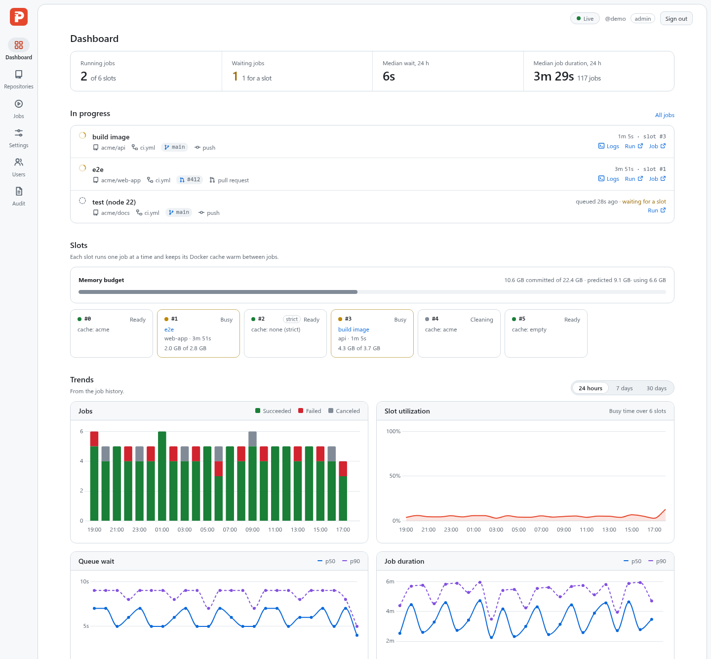
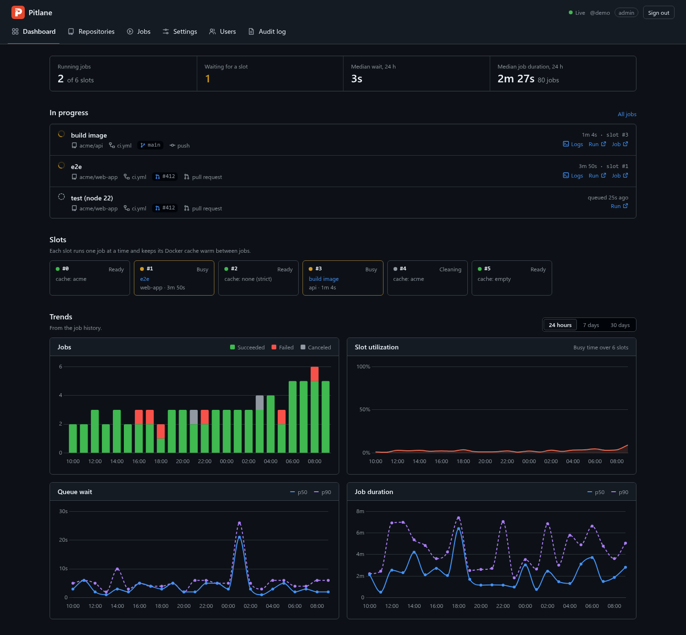
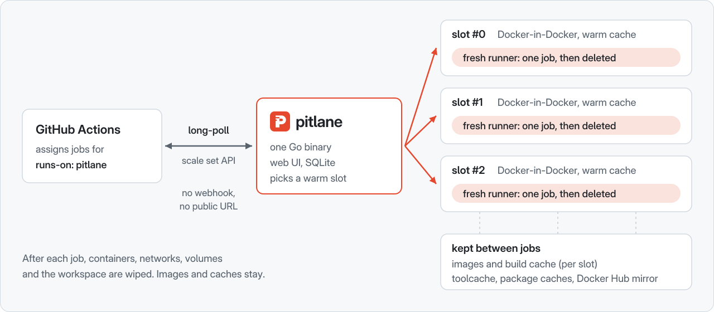
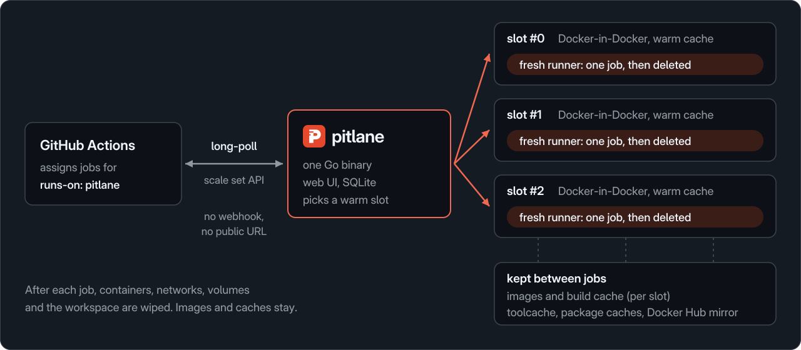

---
# Home page of the documentation site (https://turoyt.github.io/pitlane/).
# On GitHub, start from the README or getting-started.md instead.
layout: home

hero:
  name: Pitlane
  text: Ephemeral GitHub Actions runners with caches that stay warm
  tagline: Each job gets a fresh runner on your own Docker host. Docker layers, package caches and toolchains stay on disk, so a private monorepo's CI went from ~6 min 30 on GitHub-hosted runners to ~3 min. One binary, a web UI, no Kubernetes.
  image:
    src: /logo.svg
    alt: Pitlane logo
  actions:
    - theme: brand
      text: Install in two minutes
      link: /getting-started
    - theme: alt
      text: Compare with the alternatives
      link: /why
    - theme: alt
      text: GitHub
      link: https://github.com/TuroYT/pitlane

features:
  - title: 'Docker images: 393 s → 127 s'
    details: Each slot keeps its own Docker daemon between jobs, so layers and services images are already there. On the benchmark below, image builds and smoke test took 127 s against 393 s on GitHub-hosted runners.
  - title: actions/cache on local disk
    details: actions/cache and setup-* actions with cache are served by the Pitlane host, with no workflow change. 200 MB are saved in about 1 s, against 9 s on GitHub's cache.
  - title: A fresh runner for every job
    details: Each job gets a brand-new runner that is deleted afterwards. npm/pnpm/yarn/pip/Go caches and toolchains stay on disk, per GitHub owner.
  - title: No public URL
    details: Pitlane long-polls GitHub through the official scale set API, the one GitHub's Kubernetes controller uses. Jobs start within seconds, and there is no webhook to expose.
  - title: A web UI with roles
    details: Live slots and runners, every job traced back to its repository, workflow and pull request, per-job peak memory, and admin, operator and viewer roles with an audit log.
  - title: One static binary
    details: Install it with systemd, Docker Compose, or a one-liner on Proxmox. It updates itself and checks the release's Sigstore attestation first.
---

## Quick start

On a Linux host with systemd (Docker is installed if missing):

```sh
curl -fsSL https://github.com/TuroYT/pitlane/releases/latest/download/install.sh | sudo sh
```

Open the printed URL, enter the setup token (`pitlane setup-token`), click
**Create GitHub App**, install it, enable a repository, and use the label:

```yaml
jobs:
  build:
    runs-on: pitlane
```

Docker Compose and Proxmox installs are in [Getting started](getting-started.md).

## Faster than GitHub-hosted runners

Measured on a real-world private monorepo CI (pnpm workspace, Nuxt + Prisma,
Postgres/Redis service containers, three Docker image builds), all jobs running
in parallel, warm caches. Pitlane ran in an unprivileged Proxmox LXC container
with 12 vCPU and a modest RAID disk.

| | GitHub-hosted (`ubuntu-latest`) | Pitlane |
| --- | --- | --- |
| **Whole CI (longest job)** | **~6 min 30** | **~3 min** |
| Job pickup | queue + VM boot | 6 s |
| Docker images & smoke test | 393 s | **127 s** (3.1×) |
| Dependency install (`setup` step) | 30–40 s | **21–26 s** |
| Prisma migrations | 77 s | **59 s** |
| Lint & format | 40 s | **38 s** |
| Unit tests | 161 s | **159 s** |

CPU-bound steps depend on your hardware: a job on a saturated host is not
faster than on a 4-vCPU GitHub runner. The dashboard compares, for each of your
jobs, the median duration on Pitlane with the same job on GitHub-hosted runners.

## The dashboard




<sub>Screenshot with demo data.</sub>

## How it works




A **slot** is a long-lived Docker-in-Docker daemon. When GitHub assigns a job to
your `pitlane` label, Pitlane picks a free slot (preferring one that already ran
this repository, so its cache is hottest), starts a fresh runner container in
the slot's network namespace, and lets it run exactly one job. Afterwards, the
job's containers, networks, volumes and workspace are wiped, while images and
build cache stay. Read more in [How it works](how-it-works.md).

## Limits

Pitlane is young, and has limits worth knowing before you install it:

- Linux runners only (amd64 and arm64), on GitHub.com.
- Each slot is a privileged Docker-in-Docker container: a job can take over the
  host. Run code you trust, on a host dedicated to CI ([Security](security.md)).
- Public repositories run in strict mode (throwaway caches, wiped slot), which
  keeps jobs apart but is not a sandbox.

[Why Pitlane](why.md) compares it with actions-runner-controller, runscaler,
GARM, terraform-aws-github-runner and hosted runners. Issues and pull requests
are welcome.
